<p align="center">
  
</p>

<p align="center"><a href="README.md">Deutsch</a> · <strong>English</strong></p>

<h1 align="center">Plotwerk</h1>

<p align="center">
  <strong>Write and plan your novel – locally on your Mac.</strong><br>
  Manuscript, chapter plan, characters, timeline and research in one place.<br>
  An AI reads along if you want it to, but never writes a single word for you.
</p>

<p align="center">
  <a href="https://github.com/leonatwork/plotwerk/releases/latest/download/Plotwerk.dmg"></a>
</p>

<p align="center">
  <a href="https://github.com/leonatwork/plotwerk/releases/latest"></a>
  <a href="LICENSE.md"></a>
  <a href="https://github.com/leonatwork/plotwerk/actions/workflows/ci.yml"></a>
</p>

<p align="center">
  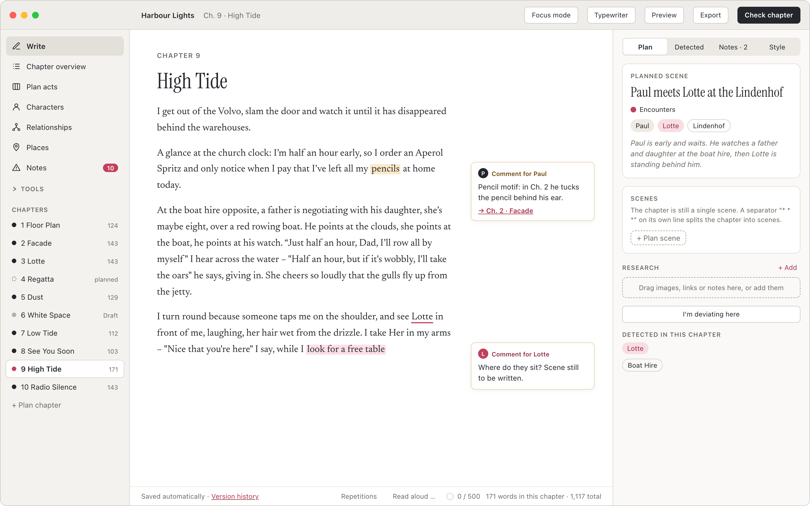
</p>

---

## Why Plotwerk?

- **Your text belongs to you.** Everything is stored as Markdown and JSON in an ordinary folder, for example
  in iCloud or OneDrive. You can read it at any time without Plotwerk, say in Obsidian or VS Code.
  No account, no cloud, and without an internet connection everything works except the AI.
- **The AI never writes.** It makes no wording suggestions and has no write access. It only
  observes: contradictions, open threads, timing errors, characters who suddenly sound different. Every
  observation needs a verbatim quote from your book, otherwise it is discarded.
- **Plan and text are kept apart.** What you plan and what is actually in the text sit side by side.
  Deviations are recorded, not “corrected”.
- **Ambiguity is allowed.** For characters and passages you set the certainty: “confirmed”, “open” or
  “deliberately vague”. Plotwerk never reports anything deliberately vague as a mistake.

## A tour

The screenshots show the English demo novel “Harbour Lights”, which the browser demo loads when the
interface is set to English.

<table>
  <tr>
    <td width="50%">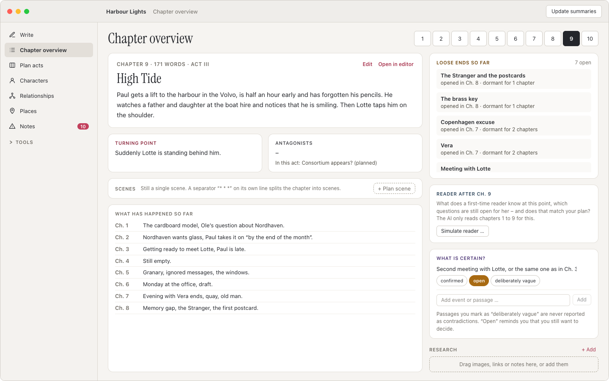</td>
    <td width="50%">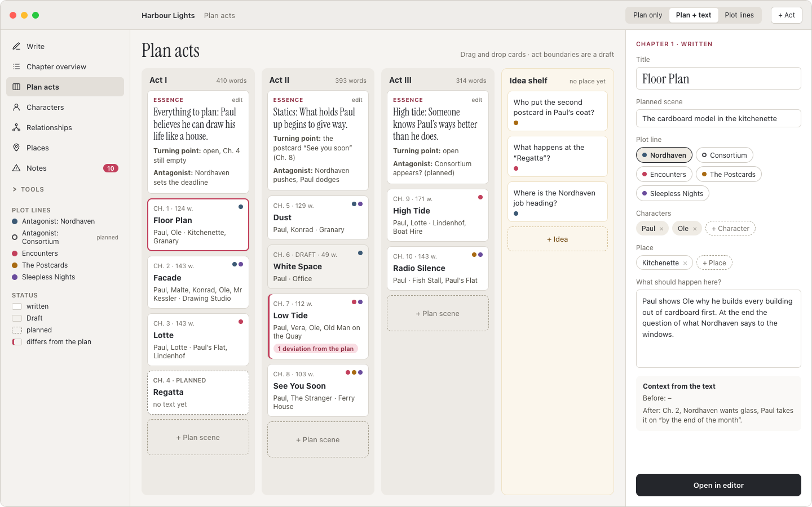</td>
  </tr>
  <tr>
    <td><strong>Chapter overview</strong><br>Summary, turning point, scenes and loose ends for each chapter.
      Plus what the reader already knows at this point.</td>
    <td><strong>Plan acts</strong><br>Act board with an idea shelf. The plot line grid shows in which
      chapters a storyline is missing.</td>
  </tr>
  <tr>
    <td>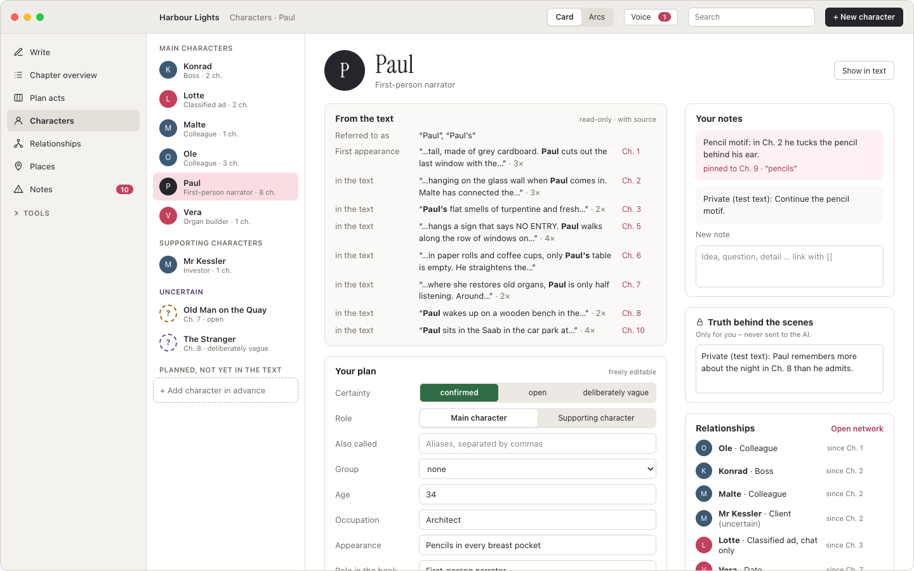</td>
    <td>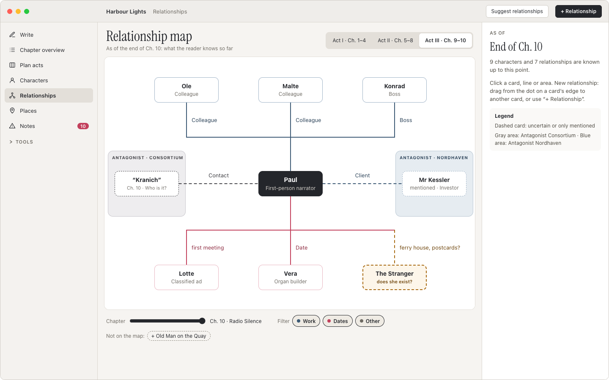</td>
  </tr>
  <tr>
    <td><strong>Characters</strong><br>“From the text” with evidence next to “Your plan”. Plus arcs across
      the whole book and a check of the character’s voice.</td>
    <td><strong>Relationships</strong><br>A map with groups and a timeline slider. It only shows what readers
      know up to a given chapter.</td>
  </tr>
  <tr>
    <td>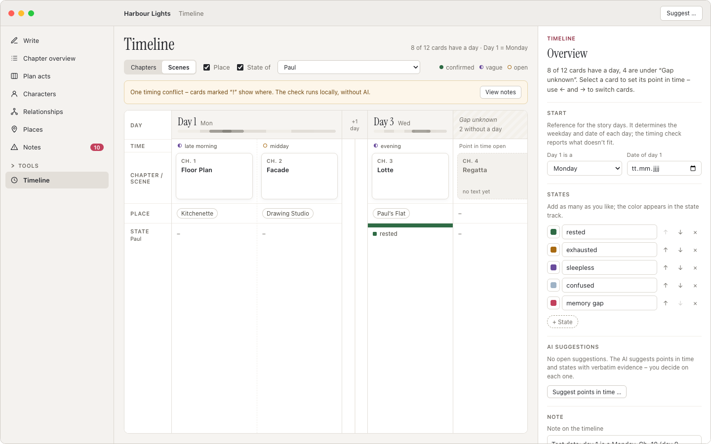</td>
    <td>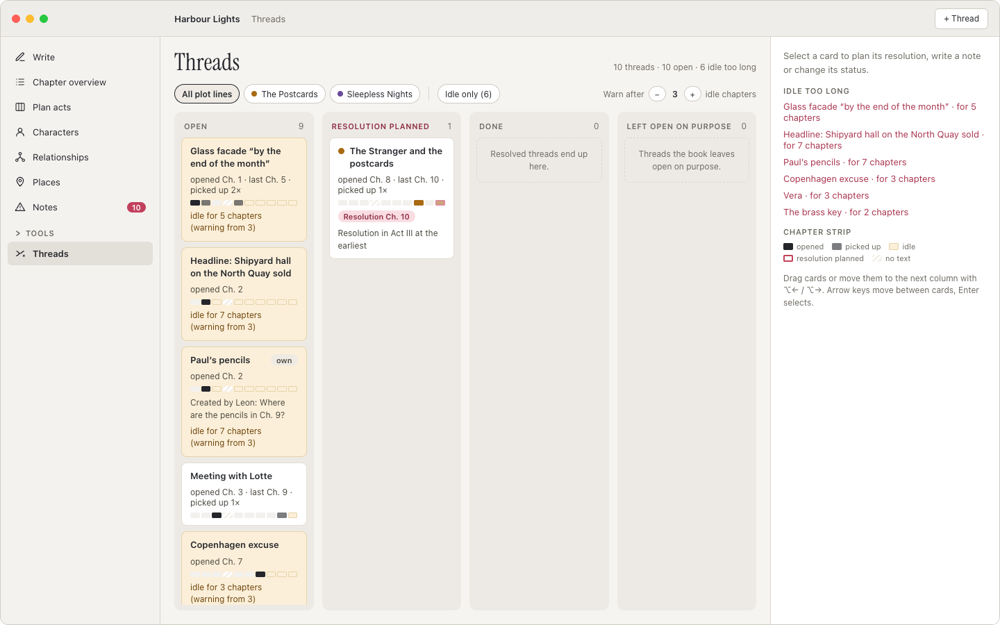</td>
  </tr>
  <tr>
    <td><strong>Timeline</strong><br>Chapters and scenes on an axis of story days. The timing check finds
      “Ch. 10 is a Thursday, day 9 would be a Tuesday” even without AI.</td>
    <td><strong>Threads</strong><br>Open questions, planned resolutions and warnings when a thread has been
      idle for too long.</td>
  </tr>
  <tr>
    <td>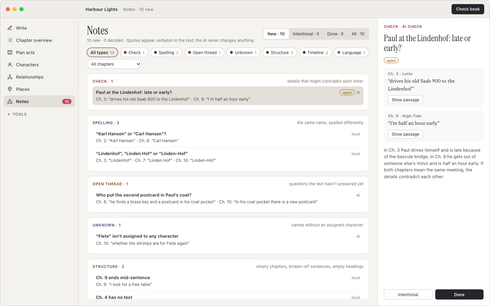</td>
    <td>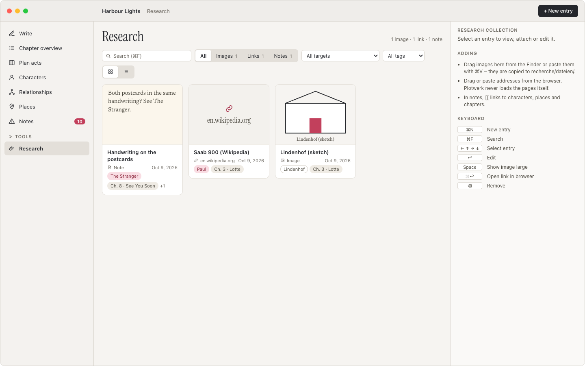</td>
  </tr>
  <tr>
    <td><strong>AI check</strong><br>Notes with a verbatim quote. The cost is estimated before every run,
      and notes you have decided on don’t come back.</td>
    <td><strong>Research</strong><br>Images, links and notes, pinned to characters, places, chapters or
      scenes.</td>
  </tr>
  <tr>
    <td>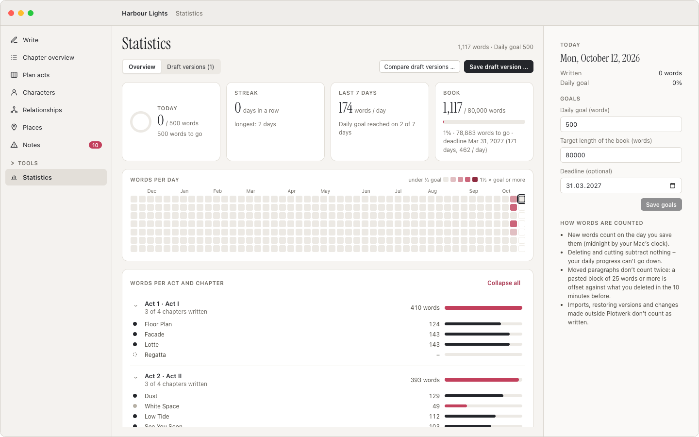</td>
    <td>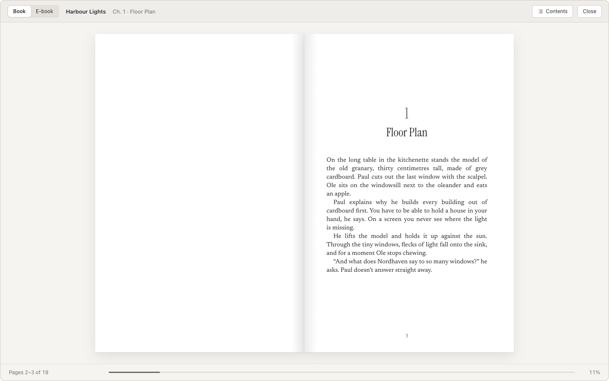</td>
  </tr>
  <tr>
    <td><strong>Statistics</strong><br>Daily goal, streak and progress towards your deadline. Deleting
      subtracts nothing, and moved paragraphs don’t count twice.</td>
    <td><strong>Preview &amp; submission</strong><br>The manuscript typeset as a book. Export as a standard
      manuscript (.docx), PDF, EPUB, synopsis and editing packet; take over edits from Word.</td>
  </tr>
</table>

Also included: German and English typography as you type (depending on the language of the book),
typewriter and focus mode, read aloud, version history with named draft versions, draft comparison, a
list of brand names for copy-editing, “Questions for the book” with evidence and a reader simulation.
Everything can also be reached via quick search (⌘K) and the Mac menu. The interface is available in
English and German. The complete description is in the **[manual](docs/handbuch.md)** (in German).

## Installation

**With one command:** open Terminal, paste, press Enter:

```sh
curl -fsSL https://raw.githubusercontent.com/leonatwork/plotwerk/main/install.sh | bash
```

The script downloads the latest version, puts Plotwerk into “Applications” and starts it. You can use the
same command to update later. What it does exactly is in [`install.sh`](install.sh).

**Or as a download:** get [Plotwerk.dmg](https://github.com/leonatwork/plotwerk/releases/latest/download/Plotwerk.dmg),
open it and drag Plotwerk into “Applications”. Because Plotwerk is not yet notarised by Apple, a warning
appears the first time you start it. Then click **“Open Anyway”** under *System Settings → Privacy &
Security*. You only need to do this once.

Requirements: macOS 12 (Monterey) or later, Apple Silicon or Intel. Updates are available via
*Plotwerk → Check for Updates…*. Nothing is installed without your confirmation.

The interface follows the language of your Mac. You can switch between English and German at any time under
*Settings (⌘,) → Language*.

## Setting up the AI (optional)

Plotwerk works completely without AI. If you want to use the AI check, enter your own access under
*Settings (⌘,)*: the **Claude API** (Anthropic) or **Claude in Microsoft Foundry**. The key is
stored in the macOS keychain, never in the project folder.

An allowlist governs what goes to the model. Chapter text, titles, names and plan fields are
allowed. Private notes and the “truth behind the scenes” never leave your Mac. Before every run
Plotwerk shows the estimated cost. A check of the whole book (80,000 words) costs roughly $0.50 to $2
with Sonnet. Results are saved and cost nothing when you open them again. Prompts and answers follow the
language of the book.

## Building it yourself

```sh
npm install
npm run dev          # browser demo with the demo novel, no Rust and no AI key needed: http://localhost:5173
npm run tauri dev    # Mac app (needs Rust)
npm test             # tests
```

Structure: `core/` is the testable logic in plain TypeScript, `src/` the React interface and
`src-tauri/` the Rust core (files, keychain, AI calls, menu, updater). More in
[`docs/architektur.md`](docs/architektur.md) and in the [manual](docs/handbuch.md#starten-entwickeln-testen)
(both in German).

## Contributing

Bug reports, ideas and pull requests are welcome, in English or German. How it works and which principles
every contribution has to follow is described in **[CONTRIBUTING.md](CONTRIBUTING.md)**. Contributions are
licensed under Apache-2.0 and confirmed with `git commit -s`; there is no separate agreement.

## What’s next

- **English interface:** included since v0.2.0 (Settings → Language), with the English demo novel
  “Harbour Lights”. More languages are welcome, see [CONTRIBUTING.md](CONTRIBUTING.md).
- **Plotwerk AI:** an optional subscription that lets the AI work without your own API key. The app
  itself stays free, and using your own key remains possible.

## License

Plotwerk is licensed under the **[Functional Source License 1.1](LICENSE.md)** (FSL-1.1-ALv2):

- ✅ Use it, including for commercially published books: your text belongs to you.
- ✅ Read, change, build the source code for yourself and pass it on.
- ❌ Offer Plotwerk or a derivative as a competing commercial product.
- 🔓 Two years after release every version automatically becomes **Apache-2.0**, i.e. fully open source.

© 2026 Leon Machnik
