<p align="center">
  
</p>

<p align="center"><strong>Deutsch</strong> · <a href="README.en.md">English</a></p>

<h1 align="center">Plotwerk</h1>

<p align="center">
  <strong>Roman schreiben und planen – lokal auf deinem Mac.</strong><br>
  Manuskript, Kapitelplan, Figuren, Zeitleiste und Recherche an einem Ort.<br>
  Eine KI liest auf Wunsch mit, schreibt aber nie ein Wort für dich.
</p>

<p align="center">
  <a href="https://github.com/leonatwork/plotwerk/releases/latest/download/Plotwerk.dmg"></a>
</p>

<p align="center">
  <a href="https://github.com/leonatwork/plotwerk/releases/latest"></a>
  <a href="LICENSE.md"></a>
  <a href="https://github.com/leonatwork/plotwerk/actions/workflows/ci.yml"></a>
</p>

<p align="center">
  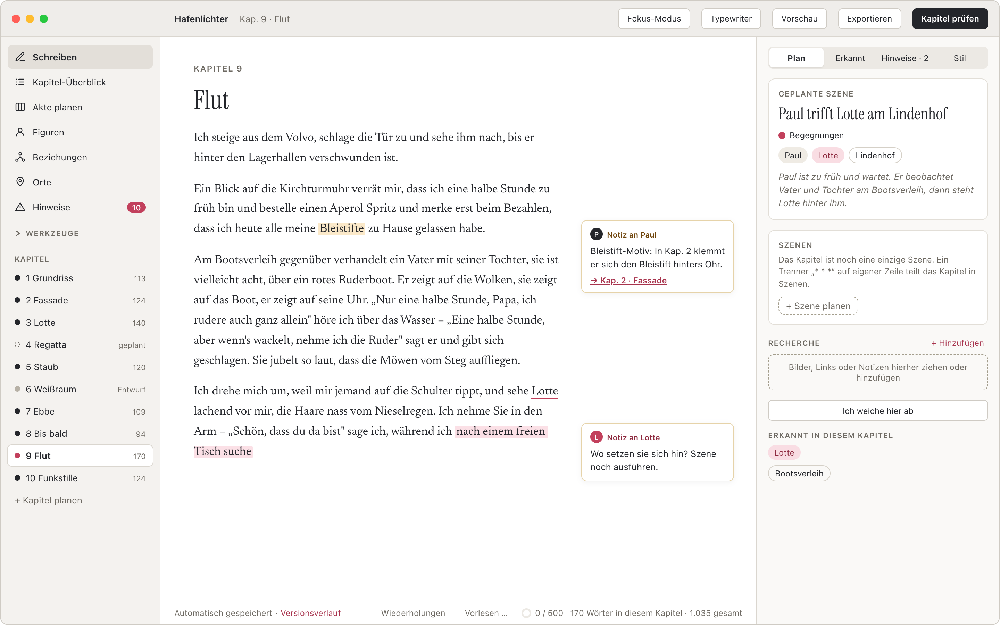
</p>

---

## Warum Plotwerk?

- **Dein Text gehört dir.** Alles liegt als Markdown und JSON in einem normalen Ordner, zum Beispiel in
  iCloud oder OneDrive. Du kannst ihn jederzeit auch ohne Plotwerk lesen, etwa in Obsidian oder VS Code.
  Kein Konto, keine Cloud, und ohne Internet funktioniert alles außer der KI.
- **Die KI schreibt nie.** Sie macht keine Formulierungsvorschläge und hat keinen Schreibzugriff. Sie
  beobachtet nur: Widersprüche, offene Fäden, Zeitfehler, Figuren, die plötzlich anders klingen. Jede
  Beobachtung braucht ein wörtliches Zitat aus deinem Buch, sonst wird sie verworfen.
- **Plan und Text sind getrennt.** Was du planst und was tatsächlich im Text steht, siehst du nebeneinander.
  Abweichungen werden festgehalten, nicht „korrigiert“.
- **Mehrdeutigkeit ist erlaubt.** Für Figuren und Stellen legst du die Gewissheit fest: „gesichert“, „noch offen“
  oder „bewusst vage“. Bewusst Vages meldet Plotwerk nie als Fehler.

## Ein Rundgang

<table>
  <tr>
    <td width="50%">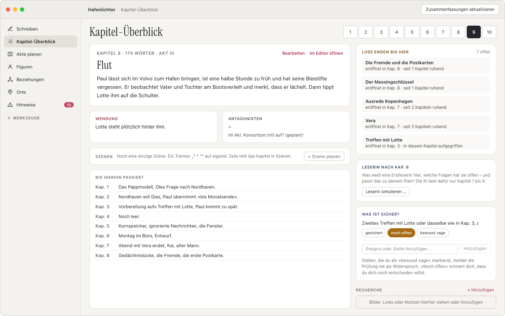</td>
    <td width="50%">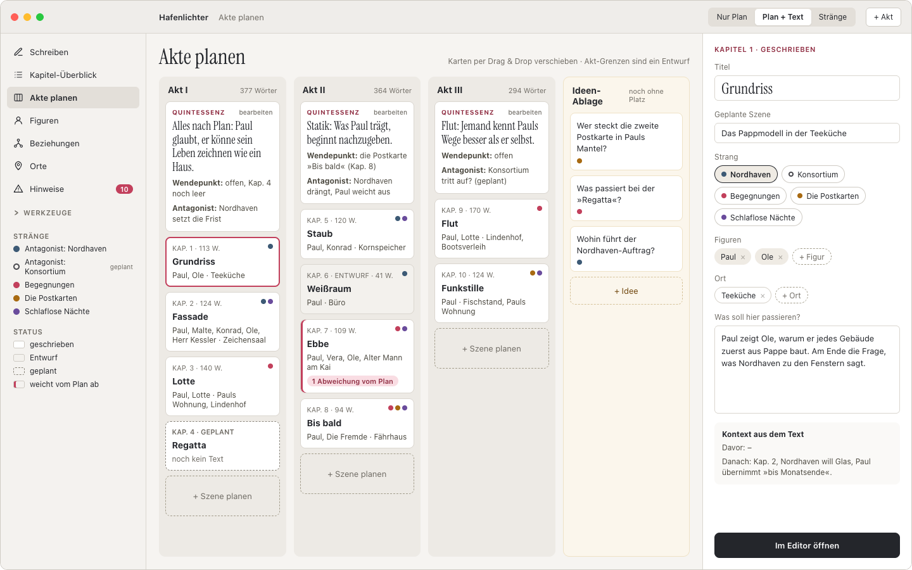</td>
  </tr>
  <tr>
    <td><strong>Kapitel-Überblick</strong><br>Zusammenfassung, Wendung, Szenen und lose Enden je Kapitel.
      Dazu, was die Leserin an dieser Stelle schon weiß.</td>
    <td><strong>Akte planen</strong><br>Akt-Board mit Ideen-Ablage. Das Strang-Raster zeigt, in welchen
      Kapiteln ein Handlungsstrang fehlt.</td>
  </tr>
  <tr>
    <td>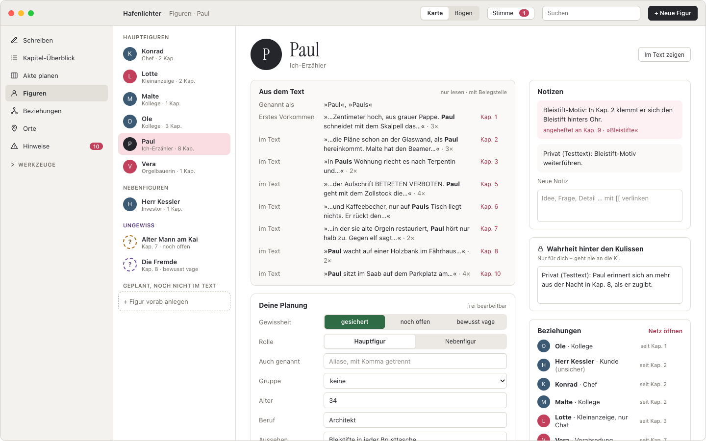</td>
    <td>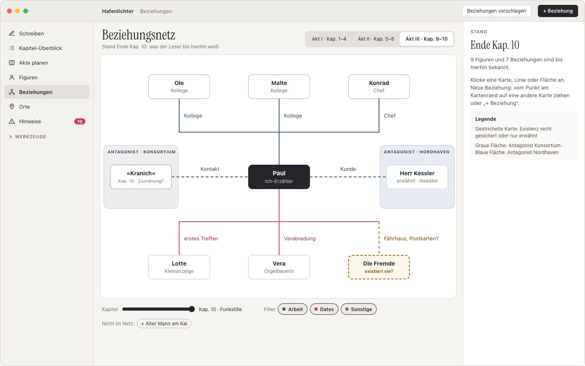</td>
  </tr>
  <tr>
    <td><strong>Figuren</strong><br>„Aus dem Text“ mit Belegen neben „Deine Planung“. Dazu Bögen über das
      ganze Buch und eine Prüfung der Figurenstimme.</td>
    <td><strong>Beziehungen</strong><br>Netz mit Gruppen und Zeitregler. Es zeigt nur, was die Leser bis
      zu einem Kapitel wissen.</td>
  </tr>
  <tr>
    <td>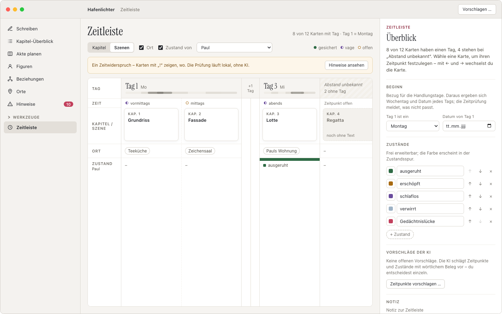</td>
    <td>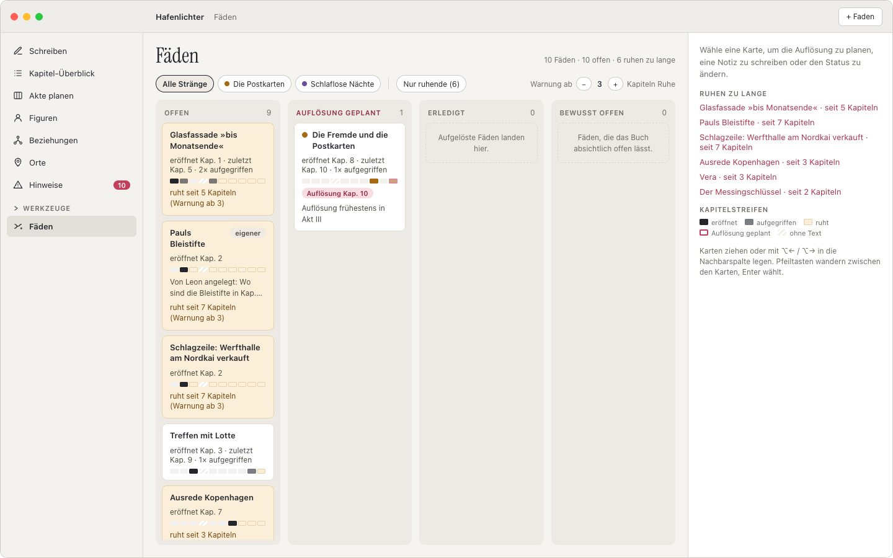</td>
  </tr>
  <tr>
    <td><strong>Zeitleiste</strong><br>Kapitel und Szenen auf einer Tagesachse. Die Zeitprüfung findet
      „Kap. 10 ist Donnerstag, Tag 9 wäre Dienstag“ auch ohne KI.</td>
    <td><strong>Fäden</strong><br>Offene Fragen, geplante Auflösungen und Warnungen, wenn ein Faden zu
      lange ruht.</td>
  </tr>
  <tr>
    <td>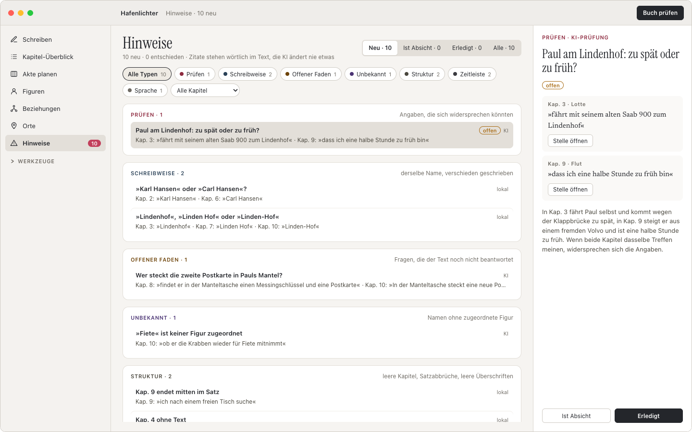</td>
    <td>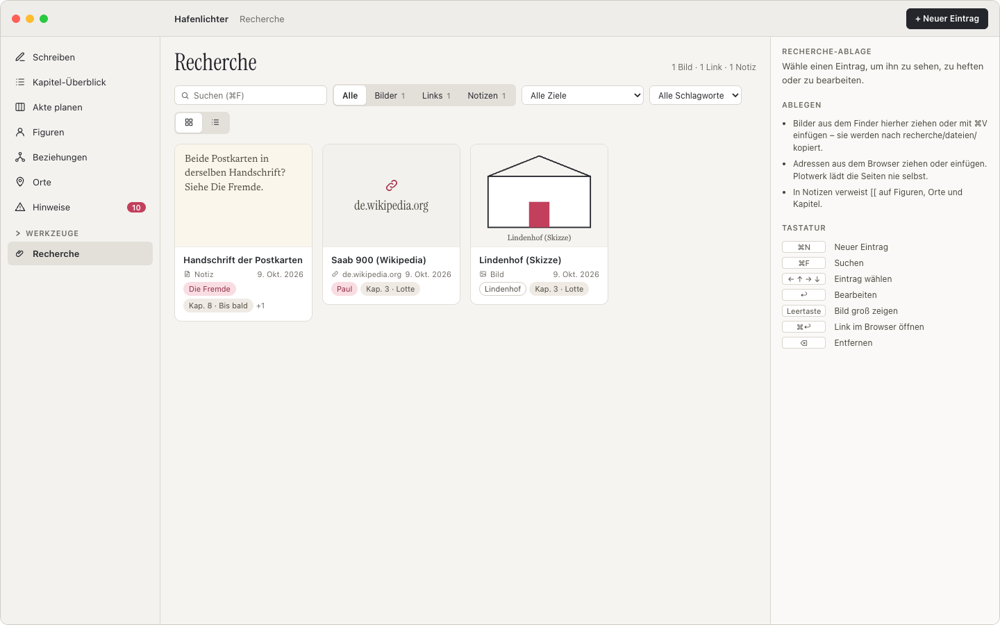</td>
  </tr>
  <tr>
    <td><strong>KI-Prüfung</strong><br>Hinweise mit wörtlichem Zitat. Kosten werden vor jedem Lauf
      geschätzt, entschiedene Hinweise kommen nicht wieder.</td>
    <td><strong>Recherche</strong><br>Bilder, Links und Notizen, angeheftet an Figuren, Orte, Kapitel oder
      Szenen.</td>
  </tr>
  <tr>
    <td>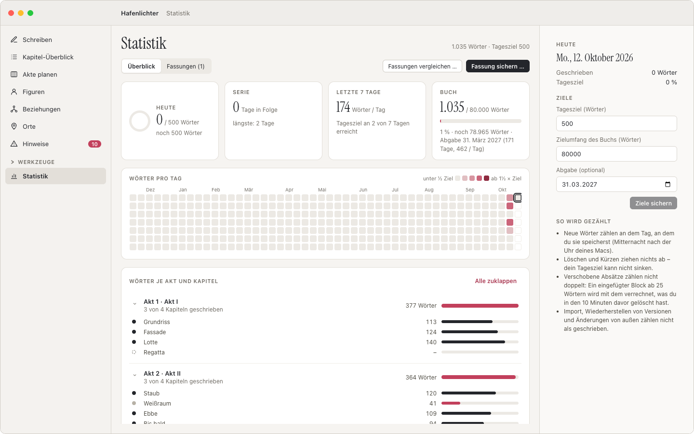</td>
    <td>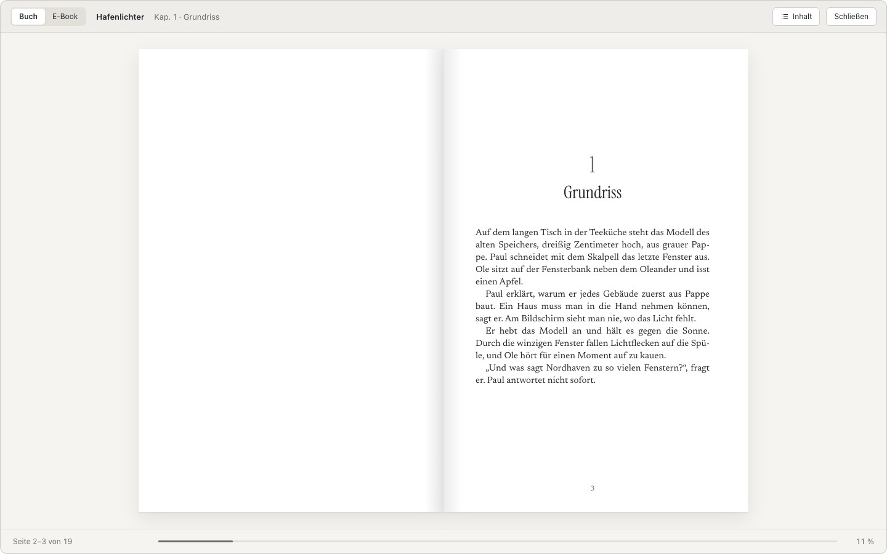</td>
  </tr>
  <tr>
    <td><strong>Statistik</strong><br>Tagesziel, Serie und Fortschritt zum Abgabedatum. Löschen zieht
      nichts ab, verschobene Absätze zählen nicht doppelt.</td>
    <td><strong>Vorschau &amp; Abgabe</strong><br>Das Manuskript als gesetztes Buch. Export als Normseite
      (.docx), PDF, EPUB, Exposé und Lektoratsmappe; Lektorat aus Word übernehmen.</td>
  </tr>
</table>

Außerdem: deutsche und englische Typografie beim Tippen (je nach Sprache des Buchs), Typewriter- und
Fokus-Modus, Vorlesen, Versionsverlauf mit benannten Fassungen, Fassungsvergleich, Markennamen-Liste fürs
Lektorat, „Fragen an das Buch“ mit Belegstellen und eine Leser-Simulation. Die Oberfläche gibt es auf
Deutsch und Englisch. Alles ist auch über die Schnellsuche (⌘K) und das Mac-Menü erreichbar. Die vollständige Beschreibung steht im **[Handbuch](docs/handbuch.md)**.

## Installieren

**Mit einem Befehl:** Terminal öffnen, einfügen, Enter:

```sh
curl -fsSL https://raw.githubusercontent.com/leonatwork/plotwerk/main/install.sh | bash
```

Das Skript lädt die neueste Version, legt Plotwerk in „Programme“ und startet es. Mit demselben Befehl
kannst du später auch aktualisieren. Was es genau tut, steht in [`install.sh`](install.sh).

**Oder per Download:** [Plotwerk.dmg](https://github.com/leonatwork/plotwerk/releases/latest/download/Plotwerk.dmg)
laden, öffnen und Plotwerk in „Programme“ ziehen. Weil Plotwerk noch nicht von Apple notarisiert ist,
erscheint beim ersten Start ein Warnhinweis. Dann unter *Systemeinstellungen → Datenschutz & Sicherheit*
auf **„Dennoch öffnen“** klicken. Das ist nur einmal nötig.

Voraussetzungen: macOS 12 (Monterey) oder neuer, Apple Silicon oder Intel. Updates gibt es über
*Plotwerk → Nach Updates suchen …*. Installiert wird nur nach deiner Bestätigung.

## KI einrichten (optional)

Plotwerk funktioniert vollständig ohne KI. Wer die KI-Prüfung nutzen möchte, trägt unter
*Einstellungen (⌘,)* einen eigenen Zugang ein: **Claude API** (Anthropic) oder **Claude in Microsoft
Foundry**. Der Schlüssel liegt im macOS-Schlüsselbund, nie im Projektordner.

Was an das Modell geht, regelt eine Allowlist. Kapiteltext, Titel, Namen und Plan-Felder sind
erlaubt. Private Notizen und die „Wahrheit hinter den Kulissen“ verlassen den Mac nie. Vor jedem Lauf
zeigt Plotwerk die geschätzten Kosten. Eine Prüfung des ganzen Buchs (80.000 Wörter) kostet mit Sonnet
grob 0,50 bis 2 $. Ergebnisse werden gespeichert und kosten beim erneuten Öffnen nichts.

## Selbst bauen

```sh
npm install
npm run dev          # Browser-Demo mit Demo-Roman, ohne Rust und ohne KI-Schlüssel: http://localhost:5173
npm run tauri dev    # Mac-App (braucht Rust)
npm test             # Tests
```

Aufbau: `core/` ist die testbare Logik in reinem TypeScript, `src/` die React-Oberfläche und
`src-tauri/` der Rust-Kern (Dateien, Schlüsselbund, KI-Aufruf, Menü, Updater). Mehr dazu in
[`docs/architektur.md`](docs/architektur.md) und im [Handbuch](docs/handbuch.md#starten-entwickeln-testen).

## Mitmachen

Fehlerberichte, Ideen und Pull Requests sind willkommen. Wie es geht und welche Grundsätze jeder
Beitrag einhalten muss, steht in **[CONTRIBUTING.md](CONTRIBUTING.md)**. Beiträge stehen unter
Apache-2.0 und werden per `git commit -s` bestätigt; einen extra Vertrag gibt es nicht.

## Wie es weitergeht

- **Englische Oberfläche:** seit v0.2.0 enthalten (Einstellungen → Sprache), mit englischem Demo-Roman
  „Harbour Lights“. Weitere Sprachen sind willkommen, siehe [CONTRIBUTING.md](CONTRIBUTING.md).
- **Plotwerk KI:** ein optionales Abo, mit dem die KI ohne eigenen API-Schlüssel funktioniert. Die App
  selbst bleibt kostenlos, der eigene Schlüssel bleibt weiterhin möglich.

## Lizenz

Plotwerk steht unter der **[Functional Source License 1.1](LICENSE.md)** (FSL-1.1-ALv2):

- ✅ Benutzen, auch für kommerziell veröffentlichte Bücher: Dein Text gehört dir.
- ✅ Quellcode lesen, ändern, für dich selbst bauen und weitergeben.
- ❌ Plotwerk oder einen Ableger als konkurrierendes kommerzielles Produkt anbieten.
- 🔓 Zwei Jahre nach Erscheinen wird jede Version automatisch **Apache-2.0**, also vollständig Open Source.

© 2026 Leon Machnik
